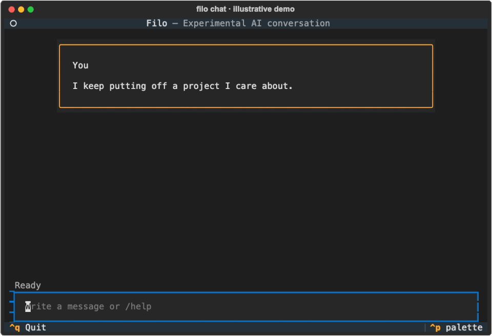

# Filo

**Experimental, self-hosted AI conversation for adult self-reflection.**

Filo runs in a terminal or one private, allowlisted Telegram chat. English is the default
language, with Italian available as an additional option. Filo keeps local state encrypted
and separates direct user reports from tentative agent hypotheses.



*Illustrative conversation in the actual terminal UI. Messages are scripted and synthetic;
this is not a live model recording.* [Static image](docs/assets/filo-demo.png) ·
[Transcript](docs/assets/README.md)

Formerly published as Therapist (v0.1–v0.3).

[Technical article: what an AI conversation should remember](https://matteodante.it/en/blog/filo-memory)
covers the memory design, corrections, and the synthetic study behind it.

> [!WARNING]
> Filo is an AI, not a psychologist or psychotherapist. It is not therapy, diagnosis, medical
> advice, emergency care, or human monitoring. Its output can be wrong. The protocol is
> experimental and has not been clinically validated.

## License and commercial licensing

Original Filo code, protocol text, and documentation are open source under
[AGPL-3.0-or-later](LICENSE). Commercial use is allowed when its conditions are met. For uses
requiring an exception to the copyleft obligations, Matteo Dante can negotiate a
[separate commercial agreement](COMMERCIAL-LICENSING.md) for material he has rights to license.
This does not prohibit compliant commercial forks.

**Third-party exception:** the bundled WHO-5 questionnaire has separate non-commercial terms.
The current package is not cleared for unrestricted commercial reuse; an agreement with Matteo
cannot override those terms. Read [the licensing guide](LICENSING.md) and
[third-party notices](THIRD_PARTY_NOTICES.md). Contributors keep their copyright under the
[contribution process](CONTRIBUTING.md) and [CLA](CLA.md).

## Install

macOS or Linux:

```bash
curl -LsSf https://raw.githubusercontent.com/matteodante/filo/main/install.sh | sh
```

Windows PowerShell:

```powershell
powershell -ExecutionPolicy Bypass -c "irm https://raw.githubusercontent.com/matteodante/filo/main/install.ps1 | iex"
```

The installer needs no administrator privileges, existing Python, or Git checkout. It pins the
immutable release source, installs an isolated Python 3.12 tool with the versions in `uv.lock`,
runs guided setup, and finishes with `filo doctor`. On Linux it selects the CPU build of PyTorch:
the embedding model runs on the CPU, and the default Linux build adds several gigabytes of CUDA
libraries.

Moving from Therapist: Filo never reads Therapist data. Run `thera telegram-service uninstall` and
`uv tool uninstall therapist-cli` first; the steps are in
[docs/releases/v0.4.0.md](docs/releases/v0.4.0.md).

## Architecture

Each turn uses one PydanticAI agent:

```text
message
  -> bounded encrypted longitudinal retrieval
  -> root protocol + compact verified skill catalog
  -> separate JSON case-data message
  -> one agent run with optional semantic skill/tool use
  -> validated reply
  -> atomic transcript and staged-state commit
```

The root protocol is never concatenated with user data. A skill body is loaded only if the model
semantically calls `load_skill`; no skill is also valid. At most one skill and one
intervention approach are used per turn. There is no keyword router, process classifier, state
machine, or stored chain-of-thought.

The experimental behavior pack in `protocols/transdiagnostic/` has a short root protocol and eleven
skills (emotion, help and direction, formulation, repair, review and follow-up, thinking,
self-criticism, flexibility, a small behavioral step, practical problems, and support/closure). The
agent offers one owned observation when it has enough material, suggests one small step when change
is wanted, follows up on what was tried, asks what ambiguous wording means before giving emergency
resources, and in long sessions mentions from time to time that it is an AI.

The agent may call tools repeatedly to refine retrieval or stage distinct evidence-supported
changes. Integrity is enforced over the whole staged turn—two new user reports, one new hypothesis,
one intervention change, exact evidence, valid IDs, and non-conflicting record mutations—before one
atomic commit.

The typed output contains the visible reply plus observable audit metadata: selected skill and
referenced claim/intervention IDs. Only the reply is shown as the conversational response. Replies
have a 4,000-character application cap; the protocol asks for the shortest natural form suitable to
the moment.

## Memory

Encrypted local state includes transcripts, successful model history, sessions, claims, case
formulation, conversational preferences, intervention outcomes and unwanted effects, support
choices, and a derived semantic index.

- `origin` distinguishes `user_statement` from `agent_hypothesis`.
- `fit` independently records `fits`, `partly_fits`, `does_not_fit`, `unsure`, or an unreviewed
  state.
- `lifecycle` independently records `active`, `superseded`, or `archived`.
- Concrete details of your life are not extracted into claims: they stay in the encrypted
  conversation archive, where retrieval finds them. Claims are kept only for recurring patterns and
  stated preferences worth revisiting, plus hypotheses, interventions, and support choices.
- Exact evidence quotes support new user reports, reviews, corrections, preferences, and support
  choices. A pattern or preference may store that quote or shorten it by dropping your own words in
  their original order, never substituting or reordering them and never altering a negation, and
  the full quote stays beside it.
- No quote is taken out of the clause that qualified it, so a refusal cannot be recorded as
  agreement to an exercise.
- A hypothesis remains an agent hypothesis even when the user says it fits.
- Corrections preserve superseded history, with the time each claim stopped holding, in export
  while preventing old wording from returning in active context.
- What you say about another person, or about being watched or followed, is kept as your account,
  never as established fact about them.
- Conflicts remain explicit; semantic similarity never establishes truth.

- Claims record when you said something, and when it started only if you named a time; "last
  spring" stays a season, never a guessed date.
- Asking in the conversation to forget something you said, in any memory mode, stops it coming back
  through claims, support choices, conversational preferences, past conversations, and session
  summaries, even if it never became a claim. The archive keeps it until you delete it locally.
- Correcting a detail you gave earlier ("actually I'm still in Rome") retires the old wording the
  same way, while your correction stays in memory.

Retrieval combines lexical overlap, local multilingual embeddings, recency, focus, pending
interventions, process preferences ranked by relevance, conflicts, relevant sessions, the parts of
the formulation that bear on the message, hypotheses you rejected, and excerpts from every past
exchange, not only recent ones. The most recent session and today's date are always in context.
Results are bounded as complete JSON records. Missing embeddings fail closed.

## Privacy modes and retention

```bash
filo chat --memory-mode standard
filo chat --memory-mode transcript-only
filo chat --memory-mode ephemeral
filo privacy show
filo privacy set-default ephemeral
```

- `standard`: encrypted transcript/history plus all structured and semantic state.
- `transcript-only`: encrypted transcript/history, with no new claims, formulation mutations,
  intervention records, or support choices.
- `ephemeral`: process memory only; no conversation content is written to disk (Telegram still saves
  its update position).

Changing mode does not delete earlier data. Retention is disabled by default and can be configured
and applied explicitly:

```bash
filo retention show
filo retention set --raw-message-days 90 --session-summary-days none \
  --stale-hypothesis-days 180
filo retention dry-run
filo retention apply
filo delete-session <id>
filo delete-before 2026-01-01
```

Local deletion cannot remove provider, Telegram, plaintext export, backup, or terminal-capture
copies. See [PRIVACY.md](PRIVACY.md).

## Commands

```text
filo setup
filo chat [--plain] [--memory-mode standard|transcript-only|ephemeral]
filo telegram [--memory-mode standard|transcript-only|ephemeral]
filo telegram-service install|status|restart|uninstall
filo auth login|status|logout
filo memory show|case|sessions|interventions|wellbeing
filo memory recap [--weeks N]
filo memory review <id> fits|partly_fits|does_not_fit|unsure <evidence>
filo memory correct <id> <exact-replacement>
filo memory forget <id>
filo memory model status|verify|install|remove
filo privacy show|set-default
filo retention show|set|dry-run|apply
filo export [--output path]
filo delete-session <id>
filo delete-before <ISO-date>
filo delete-data
filo protocol validate
filo doctor
```

In chat: `/case`, `/memory`, `/sessions [id]`, `/interventions`, `/correct <id> <text>`,
`/forget <id>`, `/recap [weeks]`, `/wellbeing`, `/retry`, `/crisis`, `/end`, `/help`, and `/quit`.
The Telegram bot adds `/start`, `/status`, and `/privacy`; its memory views are read-only, and
correcting or forgetting by ID, login, export, and deletion stay in the local CLI. Asking in the
conversation to correct or forget something works in both.

The supported first-alpha provider is a personal ChatGPT Plus/Pro account through the experimental
`codex:` OAuth path. A running chat or Telegram listener renews the ChatGPT token on its own before
it expires or after a rejected request, and picks up `filo auth logout` or a new login without a
restart. Setup also lists the models of an OpenAI-compatible `local:` server when one is
reachable, so conversations can stay on your own hardware; set `FILO_LOCAL_BASE_URL` when that
server is not on `http://localhost:8080/v1`. That path carries no support claim, and the remaining
PydanticAI providers stay technical escape hatches. Telegram checks private-chat type and numeric
allowlist and keeps configuration secrets out of process arguments.

Between sessions, Filo remembers an experiment you agreed to try (what, when, and what you
expected) and asks how it went at the start of the next session. `/recap [weeks]` lists recurring
themes, what you tried, and what changed, from your records only. `/wellbeing` is an optional
WHO-5 self-check: it is offered once, and reminders every two weeks come only if you turn them on.
It shows your scores and their trend and is never a diagnosis.

When a reply fails, Filo says why and what to do: a usage limit with its reset time, a ChatGPT login
to renew (`filo auth login`), a conversation too long for the model (`/end`), or a temporary
problem. `/retry` sends the failed message again. `filo doctor` shows the login, the Telegram
service, and the last failure. A second `filo telegram` for the same data directory refuses to start.

Type `/crisis` in chat or in the Telegram bot for emergency and crisis resources (Italy/EU and US)
in your locale. It is static text with no model call, so it works when the provider is down, and it
is not archived. The same text appears at the consent prompt, and in Telegram `/crisis` works
before consent.

## Storage upgrades

Filo started its own store as a clean break from Therapist, whose data directory it never reads.
From there on, a newer Filo upgrades an older Filo store in place when it opens it, in one
transaction: an upgrade that fails its checks or is interrupted is rolled back and leaves the store
unchanged. A Filo process started before the upgrade, such as the Telegram listener, stops and asks
to be restarted. A store written by a newer Filo is
rejected without modification.

## Development

```bash
uv sync --all-groups --extra dev
uv run ruff format --check .
uv run ruff check .
uv run ty check src/filo
uv run coverage run -m pytest -m "not live"
uv run coverage report
uv run filo protocol validate
uv build
```

Live provider evals are opt-in and use synthetic transcripts only. The evaluation artifacts are
engineering regression aids, not clinical validation. Full project scope and constraints are in
[AGENTS.md](AGENTS.md); release gates are in [RELEASING.md](RELEASING.md).
